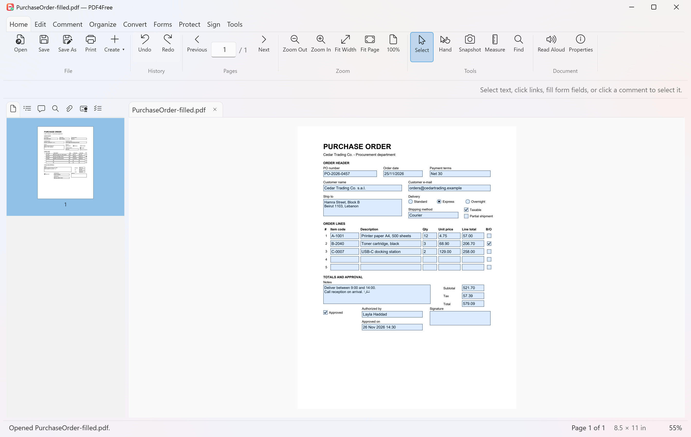

# PDF4Free

A free Windows desktop application for viewing, editing, organising, converting, signing and protecting PDF
documents. It was built by taking the tool set of Adobe Acrobat Pro as the reference and implementing each area
with open-source components (WPF, .NET 10).



> **Created completely by Claude Fable 5.2.** Every part of this project — the research into what a professional
> PDF editor offers, the architecture, all of the code, the automated checks, the application icon, the installer
> and this README — was produced by Claude Fable 5.2, Anthropic's AI model, working in Claude Code from
> plain-language requests. No line of it was written by hand.

PDF4Free is an independent project. It is not affiliated with or endorsed by Adobe; "Adobe" and "Acrobat" are
trademarks of Adobe Inc.

## Download and install

1. Download **PDF4Free-Setup.exe** from the [latest release](https://github.com/Raed-DevJourney/PDF4Free/releases/latest).
2. Run it and choose **Install**. It installs for your Windows account only, so no administrator rights are needed.
3. Start PDF4Free from the Start menu.

Requirements: 64-bit Windows 10 (version 2004) or Windows 11. Nothing else has to be installed; the .NET runtime
is inside the setup file.

Good to know:

- The setup file is not code-signed, so Windows SmartScreen may show "Windows protected your PC" the first time.
  Choose **More info > Run anyway** if you trust the download. The release page lists the file's SHA-256 checksum.
- **Run without installing** on the setup page starts the application straight from the downloaded file.
- To remove it: Windows Settings > Apps > Installed apps > PDF4Free > Uninstall.
- Unattended install: `PDF4Free-Setup.exe /S` (optional `/D=C:\some\folder`, `/NoDesktop`, `/NoOpenWith`).
- Creating a PDF from a web page uses the Microsoft Edge WebView2 runtime, which is part of Windows 11 and of
  up-to-date Windows 10. Converting Office documents uses Microsoft Office when it is installed.

## What is in the box

| Area | What PDF4Free does |
| --- | --- |
| **View** | Tabs for several documents, continuous scrolling, zoom 10 %–1600 % (sharp at any zoom), fit width / fit page, thumbnails, bookmarks, links, text selection and copy, find with match list (plain, whole word, regular expression), snapshot, measure, read aloud, print, document properties |
| **Edit** | Select, move, resize and delete text runs, pictures and vector shapes; double-click a line of text to change it; add text in any installed font; add pictures; add links; whiteout; crop; watermark (text or picture); header and footer with placeholders; Bates numbering; page background; flatten |
| **Comment** | Highlight, underline, strikethrough, squiggly, sticky note, text box, freehand pen, rectangle, ellipse, line, arrow, text stamps and picture stamps; move, edit and delete comments; comment list; text summary export |
| **Organize** | Page grid with multi-selection and drag-and-drop reordering; rotate, delete, duplicate, extract, move, reverse; insert pages from files, blank pages or the clipboard; replace a page; split (every N pages, per page, by ranges, at bookmarks); combine files |
| **Create** | From images (including multi-page TIFF), text files, Word / Excel / PowerPoint documents, web pages and local HTML, the clipboard, a scanner (WIA), or blank |
| **Export** | Word (.docx, editable text or exact page pictures), Excel (.xlsx), PowerPoint (.pptx), images (PNG, JPEG, TIFF, BMP), text, HTML, and all embedded pictures |
| **Scan & OCR** | Recognise text with the OCR engine built into Windows and add an invisible, searchable text layer; copy the recognised text of a page |
| **Forms** | Fill text fields, date and date-and-time fields (calendar and time picker), check boxes, radio buttons, dropdowns and lists; design forms with all of those plus signature fields; field list; reset; flatten; export and import field data as CSV |
| **Protect** | Open and permissions passwords with AES-256 or AES-128 and permission flags; honours restrictions on protected files until the permissions password is entered; redaction (mark areas or text, find-and-mark by text or pattern such as e-mail addresses and card numbers, apply permanently); remove hidden information |
| **Sign** | Draw, type or import a handwritten signature and place it (signatures are remembered); add the date; certificate-based digital signatures (visible or invisible) from the Windows certificate store or a .pfx file; signature validation; create a self-signed digital ID |
| **Tools** | Compare two PDFs word by word with side-by-side marked pages; batch-process many files; file attachments; bookmark editing; compress (image downsampling and recompression); undo / redo for every edit |

## How it compares with Acrobat Pro

"Yes" means the feature is there and was exercised; "Partly" means a simpler version; "No" means not built.

| Acrobat Pro capability | PDF4Free | Notes |
| --- | --- | --- |
| View, navigate, search, print | Yes | Single continuous page column (no two-page spread or full-screen mode) |
| Edit text and images | Partly | Text is edited one line at a time (the line is rewritten in a matching installed font); no paragraph reflow. Objects nested inside form XObjects cannot be selected |
| Add text, images, links | Yes | Right-to-left and complex scripts are drawn as correctly shaped outlines; Latin text around them stays real text |
| Crop, rotate, delete, insert, extract, reorder, split, combine | Yes | |
| Header / footer, watermark, background, Bates numbering | Yes | Added content is not tracked for later one-click removal (use Undo) |
| Comments and markup, stamps | Yes | No reply threads, no shared (cloud) review |
| Fill forms | Yes | AcroForm only. XFA (LiveCycle) forms are detected and reported but cannot be filled. Form JavaScript is not run, so there are no calculations or custom validation; date fields are the exception, recognised from Acrobat's standard date scripts and handled by PDF4Free itself |
| Create forms | Partly | Text, date, date and time, check box, radio, dropdown, list, signature fields; no automatic field detection, no buttons, calculations or number formats |
| Fill & Sign (handwritten signature) | Yes | |
| Certificate signatures and validation | Yes | CMS / PKCS#7 detached signatures with SHA-256. No timestamp server, no long-term validation (LTV), no certification levels |
| Request e-signatures, web forms, bulk send | No | These are Adobe cloud services |
| Password protection and permissions | Yes | A protected copy is written on save; the open document itself stays unlocked |
| Redaction | Yes | Each redacted page is turned into a picture so nothing can survive underneath; text is restored with OCR. Links and form fields on those pages are lost |
| Sanitize / remove hidden information | Yes | Metadata, scripts, attachments, comments, links, bookmarks, thumbnails; does not analyse hidden layers or off-page content |
| Scan and OCR | Yes | Uses the languages installed in Windows; no deskew or image clean-up |
| Convert to PDF | Yes | Office files go through Microsoft Office when it is installed (full fidelity). Without it, .docx files use a built-in converter that keeps text, basic formatting, lists, tables and inline pictures |
| Export to Word / Excel / PowerPoint | Partly | Word keeps text flow and character formatting but not tables or columns; Excel splits text into columns by spacing; PowerPoint slides are page pictures |
| Compare files | Partly | Text comparison; no comparison of images or formatting |
| Compress / optimise | Yes | Image recompression and stream compression; no font subsetting or object-stream packing |
| Action Wizard | Partly | One action applied to many files (11 actions); no multi-step sequences |
| Measure | Partly | Distance only |
| Preflight, PDF/A, PDF/X, PDF/UA, print production | No | |
| Accessibility tagging and checking | No | Read-aloud is available |
| Rich media, 3D, PDF portfolios, JavaScript | No | |
| AI Assistant, cloud storage, mobile sync | No | |

## Build it yourself

Requirements: Windows 10 (19041) or later and the .NET 10 SDK.

```powershell
dotnet run --project src/PDF4Free.App -c Release      # run the application
dotnet run --project tests/PDF4Free.Tests             # 30 engine checks
pwsh tests/ui/FormEndToEnd.ps1                        # end-to-end form test in the running application (Debug build)
pwsh build/Publish-Setup.ps1                          # build artifacts/PDF4Free-Setup.exe
```

### How it is built

```
src/PDF4Free.Core     the engine: no user interface, everything is "PDF bytes in, PDF bytes out"
  Pdfium/             P/Invoke layer over pdfium.dll: rendering, text, links, bookmarks, content objects
  Editing/            annotations, page content, pages, forms, security, redaction, OCR, compression,
                      comparison, signatures (PDFsharp plus raw PDF objects)
  Conversion/         create PDF (images, text, .docx, Office automation) and export (Office formats, HTML)
  PdfSession.cs       one open document: current bytes, PDFium view, undo history, saving
src/PDF4Free.App      the WPF application
  Views/              the page viewer (layout, rendering, tools, inline editors), page grid
  Dialogs/            option dialogs (built from one small form builder), combine, signature, compare, web capture
  Setup/              the installer and uninstaller (the setup file is the application itself)
  MainWindow.*.cs     the shell, split by ribbon tab
tests/PDF4Free.Tests  a console harness with 30 checks against generated documents
tests/ui              scripts that drive the running application (UI Automation plus a debug-only test pipe)
tools/IconBuilder     draws the application icon and writes the .ico
build                 the script that publishes the installer
samples               a form designed and filled in by the UI test, with screenshots
```

Design points worth knowing:

- **Two engines, one model.** PDFium renders and reads; PDFsharp (and PDFium for content objects) writes. Every
  edit is a function from bytes to bytes, applied on a background thread and kept as one undo step.
- **Coordinates.** The UI works in "view points": measured from the top-left of the page as displayed. One class
  (`PageGeometry`) maps them to PDF user space for any rotation, crop box or media box origin, and a check compares
  it with PDFium's own mapping.
- **Comments and form fields are real PDF objects** with their own appearance streams, so they look the same in
  other readers and stay upright on rotated pages.
- **Date fields follow Acrobat's convention.** PDF has no date field type: a date field is a text field whose
  format and keystroke actions name a pattern, such as `AFDate_FormatEx("dd/mm/yyyy")`. PDF4Free writes those two
  actions and reads the pattern back from them (including Acrobat's numbered formats), so it never has to run a
  script. A typed date is stored in the field's pattern; `2026-11-25` becomes `25/11/2026`.
- **Redaction is destructive by design.** Pages with redactions are replaced by an image of themselves; a check
  searches the raw file to prove the redacted text is gone.
- **The OCR text layer is invisible text** (PDF text render mode 3); a check compares pixels before and after.
- **The installer is the application.** It is published as one self-contained file; started under the name
  `...Setup.exe` it offers to install itself. Everything it writes is per-user, and uninstalling removes all of it.

## What was verified, and what was not

**Engine (32 automated checks):** rendering, text extraction, coordinate mapping on rotated and cropped pages,
all comment types, text and image placement, mixed left-to-right and right-to-left text, watermark / header /
Bates, page organisation, form fields, date formats and date fields (PDFium, as a second reader, is asked for the
date scripts and finds them), passwords and permissions, bookmarks, search and patterns, attachments, sanitising,
redaction, OCR, creating PDFs from text, images and .docx, compression, comparison, digital signing and tamper
detection, every export format (the Word, Excel and PowerPoint files are opened with the real Office applications
when they are installed), and undo / redo.

**In the running application:** opening, the page view, every ribbon tab, the tool options bar, drawing and markup
tools, selecting / moving / deleting comments and content objects, in-place text editing, adding text, the page
grid (rotate, duplicate), search, the comment list, watermarking, find-and-redact followed by apply and save,
placing a typed signature, the comparison window, the main dialogs, and web capture (a local HTML file, a live web
address, and an address that cannot be reached).

**Form round trip (`tests/ui/FormEndToEnd.ps1`, 17 checks):** a purchase-order form with a header, five order lines
and a totals/approval block — 50 fields: text, multi-line text, date, date and time, dropdown, list box, radio
group, check boxes and a signature field — is designed on a blank page with the application's own tools and saved
with Save As. The application is restarted, the form is checked to be blank, every kind of control is filled, and
the result is saved under a new name. After another restart every value is validated three ways: what the
application shows, what the engine reads from the file, and what a reader would display (the text of the flattened
form). The two files are in `samples/`.

**Date picker:** walked through in the running application with debug-build test hooks that raise the same mouse
and key events a person causes: clicking a day (which closes the calendar of a date field and leaves it open in a
date-and-time field), the time boxes, Enter and Esc inside the picker and outside it, F4, Tab to the next field,
and Enter on text that is not a date (the editor stays open and says what it expects).

**Installer:** silent install into a scratch folder, shortcut and registry entries checked, the installed copy
started and used (open, edit, HTML conversion), then uninstalled with every trace confirmed gone.

**Not exercised yet** (the code is in place but needs a first real-world run): printing to a physical printer,
scanning, read aloud, signing with a smart card or hardware token, drag-and-drop reordering with a real mouse,
the date picker with a real mouse and keyboard, date fields opened in Adobe Acrobat itself, very large documents
(hundreds of megabytes), and installation on a PC other than the one it was built on.

## Third-party components

| Component | Used for | Licence |
| --- | --- | --- |
| PDFium (via the `bblanchon.PDFium.Win32` package) | Rendering, text, content-object editing | BSD-3-Clause / Apache-2.0 |
| PDFsharp and MigraDoc **6.2.4** | Writing and restructuring PDFs, text-to-PDF | MIT |
| Microsoft.Web.WebView2 | Web page to PDF | Microsoft licence, redistributable |
| .NET runtime, WPF, System.Speech | Application platform, read aloud | MIT |

Details and licence texts are in [THIRD-PARTY-NOTICES.md](THIRD-PARTY-NOTICES.md).

PDFsharp is pinned to 6.2.4 on purpose. From version 6.5 PDFsharp is licensed under AGPL-3.0 and checks for a
licence at run time; upgrading would change the terms under which PDF4Free itself may be distributed.

Windows OCR and Windows Image Acquisition are part of Windows. Microsoft Office is used for conversion only when
it is already installed.

## Licence

PDF4Free is released under the [MIT licence](LICENSE): you may use, copy, modify and redistribute it, including
commercially, as long as the copyright and licence notice are kept. It comes without warranty.

The bundled third-party components keep their own licences; see [THIRD-PARTY-NOTICES.md](THIRD-PARTY-NOTICES.md).
